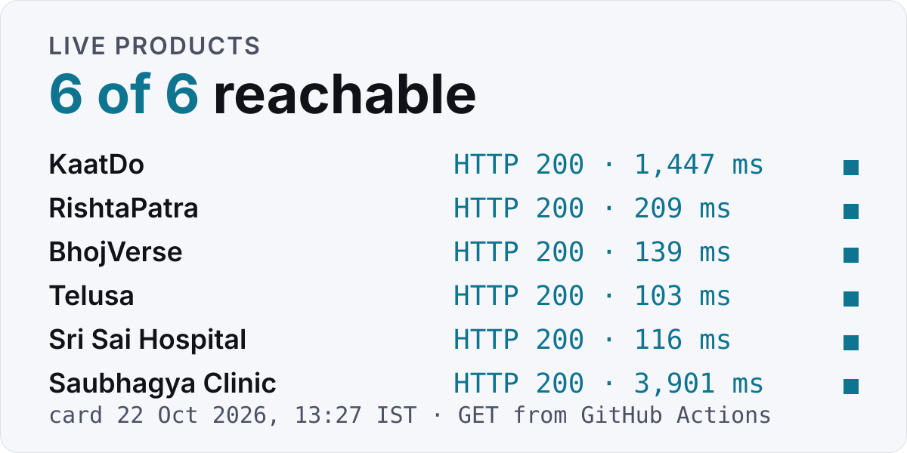
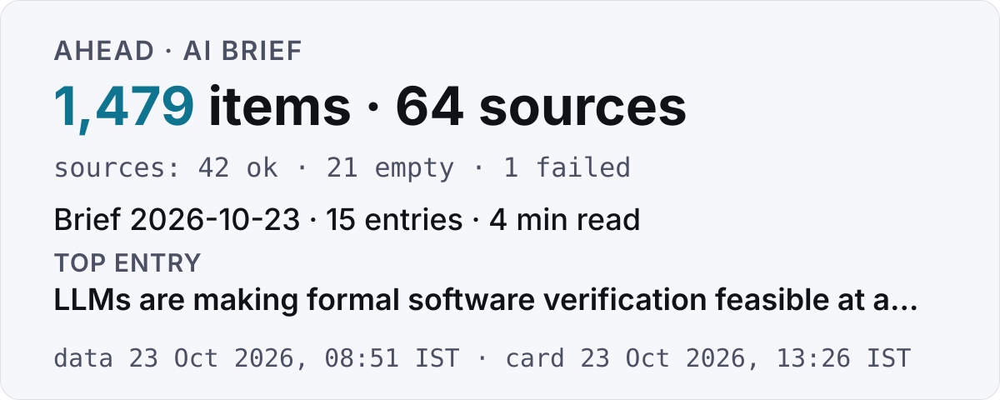
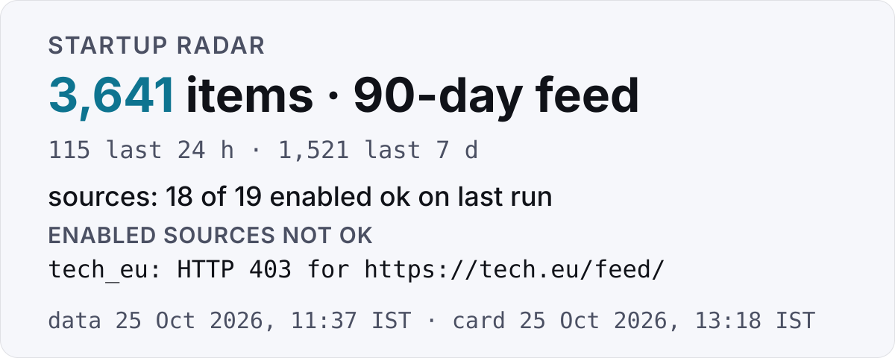
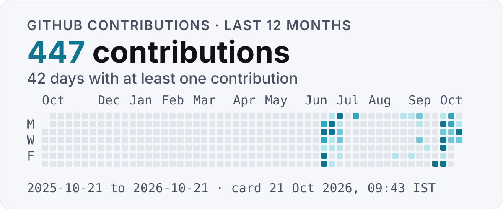

<picture>
  <source media="(prefers-color-scheme: dark)" srcset="assets/hero-dark.svg">
  
</picture>

AI Benchmarking Specialist at Amazon, Hyderabad; outside work I designed, built and operate Android apps and web platforms end to end.

[sudish.dev](https://sudish.dev) · [LinkedIn](https://linkedin.com/in/simplysudish) · [Email](mailto:sudishdreams@gmail.com) · [Hire me](https://sudish.dev/#hire-me)

Open to AI/ML Engineering Roles. Available: Immediately for interviews.

## Live work

Each product below is checked by this repository's own GitHub Action on every refresh (scheduled daily); the card shows the HTTP status and response time of that single check, failures included.

<!-- card:products:start -->
<picture>
  <source media="(prefers-color-scheme: dark)" srcset="assets/cards/products-dark.svg">
  
</picture>

Checked 30 Oct 2026, 14:29 IST from GitHub Actions: 6 of 6 product sites reachable.[^probe]
<!-- card:products:end -->

- **KaatDo** (Live). The kill switch for Indian F&O traders: a server-side risk engine that cancels every order, flattens every position and locks the day the moment your rules break. Fyers, Upstox, Zerodha, Angel One, Dhan, Groww. Stack: FastAPI, Python, Broker APIs, Vanilla JS, OCI. [kaatdo.com](https://kaatdo.com)
- **RishtaPatra** (Live). Free marriage biodata maker for Indian families: 12 languages, traditional templates, import from a resume or old biodata, privacy shield, HD PDF/PNG for WhatsApp. Everything runs in the browser; nothing is uploaded. Stack: Vanilla JS, on-device processing, PDF/PNG export, i18n (12 languages), Razorpay. [rishtapatra.com](https://rishtapatra.com)
- **BhojVerse** (Live on Google Play). Learn Bhojpuri from Hindi and English: dialogues, grammar, quizzes. Fully offline, no ads, no tracking. Stack: React Native, Expo, TypeScript, offline-first. [Website](https://sudish007.github.io/bhojverse-site/) · [Google Play](https://play.google.com/store/apps/details?id=com.bhojverse.app)
- **Telusa** (Live on Google Play). Learn Telugu from Hindi and English: speaking practice, stories, office Telugu. Free, no ads. Stack: Kotlin, Android, native. [Website](https://sudish007.github.io/telusa-privacy/) · [Google Play](https://play.google.com/store/apps/details?id=com.telusa.app)
- **Sri Sai Hospital** (Play Store listing in progress). Order Ayurvedic medicines, book doctors and skip the queue: UPI, card and COD checkout, live OPD queue tokens, order tracking, PDF bills, full Hindi support. Stack: React Native, Expo, payments, push notifications. [Website](https://sudish007.github.io/srisai-website/)
- **Saubhagya Clinic** (Patient and admin apps). Homeopathy clinic suite, Siwan: consultation booking, a pharmacy with server-verified UPI, Razorpay and COD checkout, live order tracking, PDF invoices, English and Hindi. Every word is editable from the admin app. Stack: React Native, Expo, Supabase, Razorpay, Edge Functions. [drsavitak.netlify.app](https://drsavitak.netlify.app/)

## On the record

**Experience**

- Amazon — AI Benchmarking Specialist, Hyderabad — Mar 2026 to present
  - Agentic AI assistant for Amazon sellers (RAG, LangGraph, guardrails); benchmarking AI models end to end: test plans, evaluation metrics and acceptance criteria.
- Amazon Web Services (AWS) — Machine Learning Data Associate II, Bengaluru — Oct 2024 to Mar 2026
- Amazon — Artificial Intelligence Associate, Delhi (remote) — Sep 2023 to Mar 2024

**Certifications**

- AWS Certified AI Practitioner — Amazon Web Services, Dec 2025
- AWS Generative AI Developer — Amazon Web Services, 2026

Four more: Google, Coursera, IBM, UC Davis

- Google Data Analytics Professional — Google / Coursera, Apr 2025
- Project Management (Agile/Scrum) — Coursera, Jan 2024
- Python for Data Science & AI — IBM / Coursera, 2024
- SQL for Data Science — UC Davis / Coursera, 2024

**Awards**

- Prime Player Award — Feb & Apr 2025. Highest productivity and reliability across the entire team, twice in 3 months.
- Leadership Recognition. Multiple shout-outs for Agentic AI SOP development and multilingual dataset creation.

## Selected projects

Two systems that run on GitHub Actions and publish their own data files; the cards read those files when this README refreshes.

**[Ahead](https://github.com/Sudish007/ahead)** — a personal AI intelligence dashboard: one static page that pulls 64 sources, ranks everything and writes a 5-minute daily brief. Scheduled on GitHub Actions every six hours, deployed to GitHub Pages. [Live](https://sudish007.github.io/ahead/)

<!-- card:ahead:start -->
<picture>
  <source media="(prefers-color-scheme: dark)" srcset="assets/cards/ahead-dark.svg">
  
</picture>

Ahead data generated 30 Oct 2026, 09:50 IST: 1,463 items, 46 of 64 sources ok; brief of 2026-10-30, 15 entries.[^systems]
<!-- card:ahead:end -->

**[Startup Radar](https://github.com/Sudish007/startup-radar)** — an aggregator for new startups: product launches, funding news and accelerator batches from public feeds and APIs, in one searchable, filterable page. Scheduled hourly on GitHub Actions; GitHub runs it a few times a day in practice, and the page shows its real generation time. [Live](https://sudish007.github.io/startup-radar)

<!-- card:radar:start -->
<picture>
  <source media="(prefers-color-scheme: dark)" srcset="assets/cards/radar-dark.svg">
  
</picture>

Startup Radar data generated 30 Oct 2026, 12:35 IST: 3,685 items in the 90-day feed, 18 of 19 sources ok.[^systems]
<!-- card:radar:end -->

Also:

- [SageMaker Smart Stats](https://github.com/Sudish007/sagemaker-smart-stats) — a JavaScript productivity-analytics tool built at AWS: automated metric tracking, surfaced workflow bottlenecks, and saved ~45 minutes per associate daily across a 200-person team.[^stats]
- [Enterprise Fiber Management System](https://github.com/Sudish007/fiber-management-system) — a full-stack telecom network operations platform: fiber routes, splice points, customer connections, topology mapping and real-time status tracking. TypeScript, Node.js, REST API.
- [Hoshlab](https://github.com/Sudish007/hoshlab) — an agentic company: scheduled AI agents that plan, draft and QA Instagram posts for three products, with every idea, draft, approval and run stored as a file in the repo. Build in progress. [Site](https://sudish007.github.io/hoshlab/)
- [portfolio](https://github.com/Sudish007/portfolio) — the source of [sudish.dev](https://sudish.dev).

## Last 12 months on GitHub

<!-- card:calendar:start -->
<picture>
  <source media="(prefers-color-scheme: dark)" srcset="assets/cards/calendar-dark.svg">
  
</picture>

578 contributions between 2025-10-30 and 2026-10-30, 51 active days; refreshed 30 Oct 2026, 14:29 IST.[^calendar]
<!-- card:calendar:end -->

## Toolkit

Machine learning · generative AI and agents · AWS and MLOps · Python · SQL and data engineering · analytics · infrastructure · web

- **Machine Learning & Deep Learning:** PyTorch, TensorFlow, Scikit-Learn, XGBoost, LightGBM, Random Forest, CNNs/RNNs, Feature Engineering, Hyperparameter Tuning, Model Optimization, Transfer Learning
- **Generative AI & Agentic Systems:** LLM Fine-tuning (LoRA/QLoRA), RAG Pipelines, LangChain, LangGraph, CrewAI, Hugging Face, Prompt Engineering, Agentic AI, MCP (Model Context Protocol), Guardrails, AI Safety, Red-Teaming, LLM Evaluation, Vector Databases (FAISS/Pinecone)
- **AWS & MLOps (Production):** AWS SageMaker, AWS Bedrock, Lambda/EC2/S3, Step Functions, Docker, Kubernetes, MLflow, Weights & Biases, CI/CD for ML, Model Monitoring, A/B Testing, TorchServe/Triton, Prometheus/Grafana
- **Python (Production-Grade):** NumPy, Pandas, FastAPI, Pytest, OOP Patterns, Type Hints, Async/Await, Data Pipelines, Matplotlib/Plotly, Streamlit/Gradio
- **SQL & Data Engineering:** PostgreSQL, Window Functions, CTEs, Query Optimization, ETL Pipelines, Apache Airflow, Apache Spark, dbt, Kafka, Data Warehousing, Snowflake
- **Analytics & Visualization:** Tableau, Power BI, Excel (Advanced), Probability & Statistics, Weights & Biases, Jupyter, A/B Testing
- **Tools & Production Infrastructure:** Git/GitHub, Linux, Docker, Kubernetes, REST APIs, Microservices, CI/CD, Agile/Scrum, Ray Serve
- **Web Development (Side):** HTML/CSS/JS, TypeScript, Node.js, Responsive Design, SEO, UI/UX

## Contact

- Email: [sudishdreams@gmail.com](mailto:sudishdreams@gmail.com)
- LinkedIn: [linkedin.com/in/simplysudish](https://linkedin.com/in/simplysudish)
- Portfolio: [sudish.dev](https://sudish.dev)
- Hiring: [sudish.dev/#hire-me](https://sudish.dev/#hire-me). Roles: ML Engineer, GenAI Engineer, Data Scientist, NLP Engineer, MLOps, AI Solutions Architect. Location: Anywhere (preferred: Bengaluru / Hyderabad / Pune / Gurgaon). Notice period: 30 Days / Negotiable.

Also available for freelance AI/ML consulting: custom ML models, data pipelines and AI tools, from idea to production. [Services and pricing](https://sudish.dev/services.html).

How the live cards are made

`.github/workflows/refresh.yml` runs `scripts/refresh_cards.py` (Python 3.12, standard library only); it is scheduled daily at 08:13 IST and can be run on demand. GitHub may delay or skip scheduled runs, so each card prints the time it was actually generated. The script reads the sources named on each card, draws light and dark SVGs with the site's Inter and JetBrains Mono subsets embedded, rewrites the alt text and caption under each card, and commits as `github-actions[bot]` when anything changed. Nothing is hot-linked from a third-party service.

---

[sudish.dev](https://sudish.dev)

[^probe]: One HTTP GET per product website from a GitHub-hosted `ubuntu-24.04` runner at the time printed on the card, redirects followed; "reachable" means a final status of 200–399 received within 20 seconds, measured from the request start to the first 64 KB of the body. The response time is that single request's wall-clock time, not an average. A 403 can mean a bot-protection layer blocked the probe rather than the site being down; the status is shown either way.
[^systems]: Read at refresh time from each project's published data: Ahead `data/meta.json` and `data/digests/` (an "empty" source is a successful fetch that kept no item), Startup Radar `data/stats.json` and `data/sources.json` ("items" is the source's own 90-day-feed count; "ok" means the source ran and recorded no error on its most recent run). The data's own generation time is printed on the card.
[^stats]: Figure as published on sudish.dev (AWS role bullet); the "~" is the site's own approximation. Not re-measured for this page.
[^calendar]: Counted by GitHub's GraphQL `contributionCalendar` for the date range printed on the card, queried with this repository's default Actions token. Colour steps are GitHub's own quartile levels. The total can differ from the graph on github.com.
