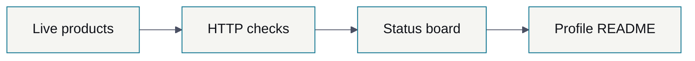
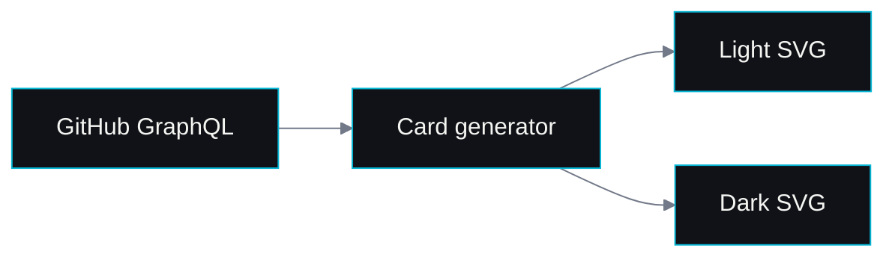

# Mermaid theme test

Temporary research fixture for profile README v2. The implementation step removes this file.

## A. Opaque dark context

## B. Opaque light context

## C. Transparent canvas with opaque dark nodes

